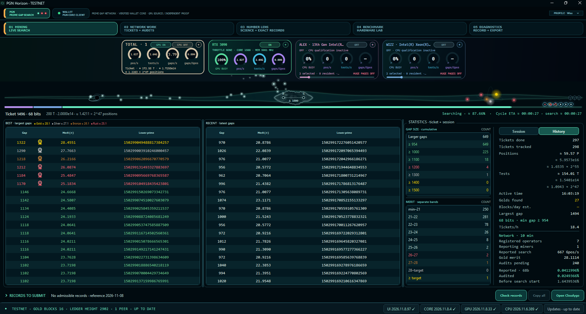
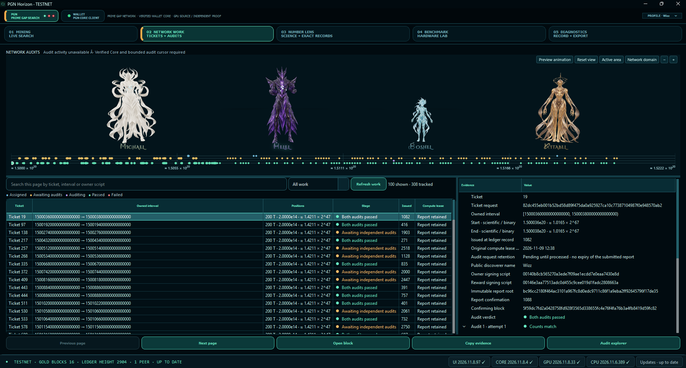

# Prime Gap Network
### Community-driven prime-gap research

Prime Gap Network (PGN) is a collaborative initiative conceived by **Rob Smith**, known as **robert44444uk** in the prime-gap community. Robert develops the scientific and network rules; Wizz works on the software implementation.

[Community website](https://wizz13150.github.io/prime-gap-network.github.io/) · [Discord](https://discord.gg/qZ2DerDMXQ) · [Standalone Scout](https://github.com/wizz13150/prime-gap-scout)

## Two separate applications

**Prime Gap Scout** is the standalone prime-gap search tool. It needs no wallet, blockchain or PGN network. Its releases and console documentation belong to the [Scout repository](https://github.com/wizz13150/prime-gap-scout).

**PGN Horizon** is the network client in this repository: an integrated wallet, optimized search engines, automatic work tickets, independent audits, and views of network evidence. It owns its engine runtime and does not require an installed Scout application.

## Horizon in use

<table>
<tr><th>Mining</th><th>Tickets + Audits</th></tr>
<tr>
<td width="50%"></td>
<td width="50%"></td>
</tr>
</table>

Select either image to view it at full resolution. These are captures of the current supervised testnet preview.

## Windows supervised testnet preview

### Whole-audit progress and integrated audit preview

Interface **2026.11.8.99** / GPU runtime **2026.11.8.34** / Core **2026.11.8.5** preserve results across the internal partitions of the same audit. Results reset when the audit changes or research begins. The first two actually observed audits fill the first two progress sections; additional audits use orange sections retained throughout research. Current-step and cycle ETA are estimates; unavailable future quantities keep the cycle ETA unknown rather than inventing a time.

The Network Work scene is preloaded during application startup. Names are centered, the resize minimum preserves their visibility, Reset view restores the initial pane size, and transient messages do not shift the layout. The application window can move beyond screen edges without forced recentering. Statistics use stable typography. Scene framing follows the pane height. The pane resize no longer causes lateral jumps. Further character gesture work is paused.

Startup diagnostics retain a bounded structured failure through process exit and into an export started afterwards: startup stage, failing resource basename, OS error and relevant call sites. This path has been tested using the actual frozen host through native process capture and ZIP export. It does not establish the cause of Robert's machine-specific startup failure. Diagnostics are optional and are never a prerequisite for mining.

[Download Windows x64](https://github.com/wizz13150/prime-gap-network/releases/download/horizon-testnet/PGN-Horizon-testnet-Windows-x64.zip) · [Download Ubuntu x86_64](https://github.com/wizz13150/prime-gap-network/releases/download/horizon-testnet/PGN-Horizon-testnet-Ubuntu-x86_64.tar.gz) · [Release and checksums](https://github.com/wizz13150/prime-gap-network/releases/tag/horizon-testnet) · [Tester guide](docs/TESTING.md)

This is the current portable Windows preview for supervised tests on the PGN testnet. Use this epoch's package when joining; older alpha packages belong to an older test network.

1. Extract the complete folder and launch **PGN-Horizon.exe**. PGN Core and the engine runtimes are included.
2. If no wallet is configured, Horizon opens Wallet → Wallet management automatically. Create a testnet wallet or open an existing Core data folder there. Existing configured wallets reopen normally; nothing is created without your action.
3. Let the integrated encrypted connection synchronize. No VPN or public wallet RPC port is required.
4. Choose your public name in Profile, then turn a GPU on. No coordinator approval, enrollment or diagnostic recording is required. Core verifies the signatures and work automatically. Never send wallet files, keys or RPC credentials.
5. Turn your GPU on. CPU mining can remain OFF. Network service may assign audits before a new search ticket; that work uses the GPU and is part of the same normal cycle. Starting Diagnostics recording is never required to turn mining on. Reports, audits and searches share the normal worker.

Core **2026.11.9.8** retains the elapsed-time difficulty controller activated at ledger height **3456**: median chain time, a 30-minute response scale and merit floor 21. The transition and decline between Golds have been observed on the running testnet. History, genesis and wallets are retained. Coordination records remain part of this laboratory; final Gold-only architecture is separate work.

Core 8 avoids reconstructing the audit ledger when no audit settlement is due. On a retained 3,760-record chain, level-4 verification of eight blocks took 21.25 seconds before and 6.98 seconds after, with identical native state. This measures block verification, not GPU search throughput.

### What this preview provides

- Optimized NVIDIA CUDA search images for SM86/SM120 and 67–95-bit intervals, with four memory profiles. The current network search domain begins inside the 68-bit band and ends at 2⁹⁵, exclusive.
- Automatic tickets, durable audit commitments, report disclosure and independently assigned checks. Discovery, audit acceptance and payment are shown as separate states.
- A real testnet wallet using **tPGN**, including available and immature balances, send/receive and wallet management. There is no conversion into mainnet PGN.
- Best/Recent results, shared device cards, ticket/audit evidence, network history, and an Atlas with a graduation for every bit in its complete-domain view.
- Optional signed updates for the interface, Core, GPU runtime and CPU runtime. The updater verifies payloads and preserves wallet data; updates are not forced. Component archives are fetched by the in-app updater; download the portable Windows archive to run Horizon.
- Manual diagnostic ZIP export and scientific CSV export in **Number Lens → Native GPU observations → Export results (CSV)**. Exact gap endpoints, gap-size counts and provenance are retained for completed searches. Historical missing populations are disclosed, never invented.

### Qualification and remaining scope

Controlled laboratory clients have exchanged blind audit commitments and revealed matching answers. A normal isolated controller recovered its retained work and automatically published an accepted Gold, crediting **171 immature tPGN** to its wallet. These are controlled laboratory identities, not independently operated human testers or exhaustive power-loss testing.

CPU network operation/Huge pages and physical SM120 performance need wider qualification. Windows Huge pages require the account's **Lock pages in memory** right and a new sign-in; the assisted privilege-grant flow is not included. The CPU card reports real allocation status rather than assuming it is enabled.

The test ledger includes coordination records without coin issuance. **Ledger height is not Gold-block count.** Final Gold-only chain architecture, final economics and large-network load qualification remain development work. Complementary pseudoprime recovery is deferred in this preview; exhaustive scientific completeness against that case is not claimed. Ordinary network audits and exact Gold verification remain enabled.

**Ubuntu:** the complete portable archive contains the current application, Core, engine runtimes and source. Run `./launch-horizon.sh`; for a coherent source build, follow [the single build command](docs/BUILDING.md#coherent-linux-testnet-build). It builds the interface, Core, engine host, CPU controller and updater, then assembles their manifests and current-network bootstrap. The Linux lifecycle has been checked on Ubuntu 24.04 with the real Horizon/Core executables: install, normal restart and retained wallet. Ubuntu 26.04 and GPU execution on the tester's hardware still need field qualification; a successful source build alone is not a GPU-mining claim. Older alpha packages belong to an older network epoch.

## Recovery and diagnostic update

Interface **2026.11.9.106**, Core **2026.11.9.8** and GPU runtime **2026.11.9.41** retain current-network templates, bounded startup failure traces and automatic work resumption after an update. The updater distinguishes local connection failures from server outages, retries a temporary HTTP 500/502/503/504 once only before any response bytes are delivered, verifies downloaded components, installs them as a coherent code cohort and retains a recovery path. Fresh installations keep the Core configuration in the user configuration directory and mining state in the separate user data directory; both paths survive a component update. Linux updates preserve the launcher’s execute permission, and rollback looks up Core ownership in its configured directory. Diagnostics remain optional. Robert's machine-specific startup failure has not yet been confirmed resolved.

The audit scene is still under visual revision. The native scene/Atlas trajectory integration and Robert's physical SM120 startup remain unqualified. Clean source CI builds every default target, runs the registered tests, and preserves the test log.

Audit scheduling now exposes the five independent partitions of a confirmed audit to the existing bounded GPU queue, rather than hiding subsequent partitions behind the first result. An explicit testnet laboratory option permits two locally owned audit signing identities to share that same visible worker; it is disabled by default, rejects mainnet, and does not claim economic independence. In the controlled normal-worker observation, 12 further audits passed while pending computation fell from 328 to 318 over 277 seconds. This is a measured mixed-work window, not a pure-GPU throughput benchmark or an independent-human network qualification.

Windows output retention now defers acknowledgement collection if an atomic ACK replacement briefly denies the metadata read. Unacknowledged files remain byte-identical; a later valid ACK reclaims the sealed prefix. This changes transport recovery, with no wait in the GPU output path and no change to search arithmetic. The 19 source contracts include forced transient-read failures and live reader/rotation/ACK concurrency.

## Search performance

Reference measurements for the retained active computation pipeline on an **RTX 3090**, at **1500 MHz core / 5001 MHz memory**:

| Search width | Positions per second |
| --- | ---: |
| 68 bits | 1,003.52 billion |
| 80 bits | 782.51 billion |
| 95 bits | 575.23 billion |

A position is an integer search position advanced, not a primality test. These are component reference measurements, not promises for a different GPU or for end-to-end network throughput including auditing, reporting and waiting. Scout documents the complete bit-by-bit reference table.

## Why prime gaps?

A prime gap is the distance between consecutive prime numbers. Searching for unusually large gaps combines mathematical questions with substantial computational work. PGN aims to coordinate that effort, preserve evidence, and make the results accessible to researchers and volunteer contributors.

The network design separates discovery from verification. A returned range report is committed before its audit answers are disclosed; accepted scientific results require the configured independent checks. A displayed candidate or a completed local ticket does not by itself establish network acceptance or payment.

## Building and reviewing the software

The application source is in `src/`; the Core fork is in `wallet/riecoin-core-upstream-v2606/`. Qualified optimized CUDA input sources are in `src/engine/prime_gap_native/`, accompanied by their input manifest. This snapshot excludes retired independent search prototypes from the runtime source export.

See [build instructions and provenance](docs/BUILDING.md) and [preview qualification](docs/QUALIFICATION.md). Build outputs require their own qualification before replacing the pinned runtime images. A successful compilation is not a new performance or compatibility certification.

Wallets, private keys, authentication cookies, local mining history and operator-specific runtime configuration are not repository contents.

## Background and community records

The software effort began in late July 2026 as an update to Gapcoin software, then expanded to work involving Riecoin and Primecoin. Contact with Robert opened the collaboration around his PGN initiative.

The [development copy of the historical community range register](data/community/README.md) is retained for provenance. Existing records remain under their maintainers' stewardship. They are distinct from automatic PGN tickets; Horizon does not offer manual network reservations.

## Get involved

Researchers, developers and volunteer testers are welcome. Introduce yourself in the [PGN Discord community](https://discord.gg/qZ2DerDMXQ). For troubleshooting, share only the public information and diagnostic export relevant to your issue. Never send a private key or wallet file.

## Acknowledgements

- **Rob Smith (robert44444uk)** — originator of PGN and its scientific and network design.
- **Wizz** — software implementation and integration.
- **Brian Kehrig** — original [prime-gaps-cuda](https://github.com/briankehrig/prime-gaps-cuda) work on which the CUDA prime-gap search engines used by Scout and Horizon build.
- **Périg** — original modular arithmetic acknowledged by Brian's project, retained in the search-engine lineage.
- The upstream Riecoin, Bitcoin, Gapcoin and mathematical software contributors whose work underpins the project. Existing component licence and copyright notices are retained in their respective source trees and distribution notices.

