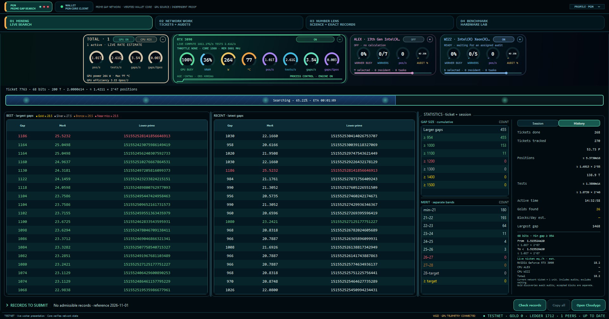

# Prime Gap Network
### Community-driven prime-gap research

Prime Gap Network (PGN) is a collaborative initiative conceived by **Rob Smith**, known as **robert44444uk** in the prime-gap community. Robert develops the scientific and network rules; Wizz works on the software implementation.

[Community website](https://wizz13150.github.io/prime-gap-network.github.io/) · [Discord](https://discord.gg/qZ2DerDMXQ) · [Standalone Scout](https://github.com/wizz13150/prime-gap-scout)

## Two separate applications

**Prime Gap Scout** is the standalone prime-gap search tool. It needs no wallet, blockchain or PGN network. Its releases and console documentation belong to the [Scout repository](https://github.com/wizz13150/prime-gap-scout).

**PGN Horizon** is the network client in this repository: an integrated wallet, optimized search engines, automatic work tickets, independent audits, and views of network evidence. It owns its engine runtime and does not require an installed Scout application.

## Current status

Horizon is a **private development testnet preview**, with play coins. The [0.1.0-alpha.1 pre-release](https://github.com/wizz13150/prime-gap-network/releases/tag/v0.1.0-alpha.1) is available for a small Windows and Ubuntu trial. It is not a production launch, a completed implementation of the final monetary rules, or a demonstrated large-network deployment.

[Download Windows x64](https://github.com/wizz13150/prime-gap-network/releases/download/v0.1.0-alpha.1/PGN-Horizon-testnet-preview-Windows-x64.zip) · [Download Ubuntu 24.04 x86-64](https://github.com/wizz13150/prime-gap-network/releases/download/v0.1.0-alpha.1/PGN-Horizon-testnet-preview-Ubuntu24.04-x86_64.tar.gz) · [SHA-256 checksums](https://github.com/wizz13150/prime-gap-network/releases/download/v0.1.0-alpha.1/SHA256SUMS.txt)

The preview includes:

- Local wallet setup through an explicit assistant, a selectable data folder, and reopening an existing wallet.
- An integrated encrypted bootstrap connection: testers do not install a VPN or expose wallet RPC.
- Optimized NVIDIA CUDA engines covering 67–95-bit searches, with cached resident execution and qualified SM86/SM120 images. There is no automatic whole-range generic search fallback.
- Automatically allocated, network-numbered tickets from a rolling pool of 10,000 available ranges. The pool is a window, not a 10,000-ticket lifetime limit. Manual reservations are disabled.
- Persistent reports and audit state. Two audit operators must be distinct from each other and from the report owner. Insufficient independent operators leave a report pending.
- GPU and CPU cards, explicit controls, dedicated CPU thread selection, Best/Recent results, compact statistics, and a bounded records display.
- A separate diagnostic recorder with an explicit ZIP export and a 2 MiB capture limit.

The CPU auditing path currently covers the **68-bit test area**. Physical testing on additional GPUs, a complete exchange with independent external auditors, final reward economics, Gold-only monetary-block rules, and large-network load qualification remain work in progress. Technical coordination-ledger height is **not** the number of Gold mining blocks.

Read [the tester guide](docs/TESTING.md) before joining. The guide distinguishes computed results, committed reports, audits, scientific acceptance, and rewards.

## Search performance

Reference measurements for the retained active computation pipeline on an **RTX 3090**, at **1500 MHz core / 5001 MHz memory**:

| Search width | Positions per second |
| --- | ---: |
| 68 bits | 1,003.52 billion |
| 80 bits | 782.51 billion |
| 95 bits | 575.23 billion |

A position is an integer search position advanced, not a primality test. These are component reference measurements, not promises for a different GPU or for end-to-end network throughput including auditing, reporting and waiting. Scout documents the complete bit-by-bit reference table.

## Why prime gaps?

A prime gap is the distance between consecutive prime numbers. Searching for unusually large gaps combines mathematical questions with substantial computational work. PGN aims to coordinate that effort, preserve evidence, and make the results accessible to researchers and volunteer contributors.

The network design separates discovery from verification. A returned range report is committed before its audit answers are disclosed; accepted scientific results require the configured independent checks. A displayed candidate or a completed local ticket does not by itself establish network acceptance or payment.

## Building and reviewing the software

The application source is in `src/`; the Core fork is in `wallet/riecoin-core-upstream-v2606/`. Qualified optimized CUDA input sources are in `src/engine/prime_gap_native/`, accompanied by their input manifest. This snapshot excludes retired independent search prototypes from the runtime source export.

See [build instructions and provenance](docs/BUILDING.md) and [preview qualification](docs/QUALIFICATION.md). Build outputs require their own qualification before replacing the pinned runtime images. A successful compilation is not a new performance or compatibility certification.

Wallets, private keys, authentication cookies, local mining history and operator-specific runtime configuration are not repository contents.

## Background and community records

The software effort began in late July 2026 as an update to Gapcoin software, then expanded to work involving Riecoin and Primecoin. Contact with Robert opened the collaboration around his PGN initiative.

The [development copy of the historical community range register](data/community/README.md) is retained for provenance. Existing records remain under their maintainers' stewardship. They are distinct from automatic PGN tickets; Horizon does not offer manual network reservations.

## Get involved

Researchers, developers and volunteer testers are welcome. Introduce yourself in the [PGN Discord community](https://discord.gg/qZ2DerDMXQ). For a private trial, share only your public audit address and diagnostic information requested by the coordinator. Never send a private key or wallet file.

## Acknowledgements

- **Rob Smith (robert44444uk)** — originator of PGN and its scientific and network design.
- **Wizz** — software implementation and integration.
- The upstream Riecoin, Bitcoin, Gapcoin and mathematical software contributors whose work underpins the project. Existing component licence and copyright notices are retained in their respective source trees and distribution notices.
